<div align="center">

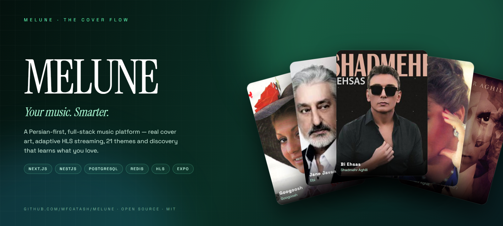

</div>

<br />

<p align="center"><sub>Cover Flow — کاور آلبومها و خوانندگانی که واقعاً در MELUNE هستند</sub></p>

<br />

## 🎬 ویدیو معرفی پروژه

<p align="center">
  <video src="docs/assets/melune-demo.mp4" poster="docs/assets/melune-demo-poster.png" controls width="960"></video>
</p>
<p align="center">
  <sub>ویدیوی ۱:۵۳ دقیقهای از اپلیکیشن واقعی ·
  <a href="docs/assets/melune-demo.mp4">دانلود MP4</a></sub>
</p>

<br />

# MELUNE — موسیقی شما، هوشمندتر

**MELUNE — پلتفرم فولاستک پخش و کشف موسیقی، فارسیمحور و RTL.**

پخشکنندهٔ Next.js، API نوشتهشده با NestJS (REST + WebSocket)، PostgreSQL و Prisma،
Redis، کارگر ترنسکود HLS با ffmpeg، کلاینت Expo و یک سرویس پیشنهاددهی FastAPI —
همه در یک مونوریپوی TypeScript نوشتهشده.

تصویر بالا از **کاتالوگ واقعی پروژه** ساخته شده (گوگوش، ابی، شادمهر عقیلی، هایده…)
و دقیقاً همان Cover Flow را نشان میدهد که در اپلیکیشن در حال اجرا است. تصاویر پایین هم
از خود نرمافزارند، نه ماکت.

<br />

<p align="center">

[](https://github.com/MFCAtash/MELUNE/actions/workflows/ci.yml)
[](https://github.com/MFCAtash/MELUNE/releases)
[](LICENSE)
[](apps/api/coverage/lcov-report/index.html)
[](package.json)
[](#پشتهٔ-فناوری)
[](#پشتهٔ-فناوری)

</p>

<br />

## 🖼 MELUNE تصویر به تصویر

پیش از جزئیات فنی، ببینید محصول واقعاً چگونه است. **۲۱ تم** تمام پوسته را رنگ میکنند —
سطوح، گرادیان برند، هاله و درخشش — و رنگ محیطی هر آهنگ از روی کاور آن استخراج میشود.
پلیر تمامصفحه دارای Sonic Canvas واکنشپذیر به صوت، متن آهنگ، نوار جستجوی موجی واقعی،
حالت تمرکز، تایمر خواب و کارت اشتراک است.

<p align="center">
  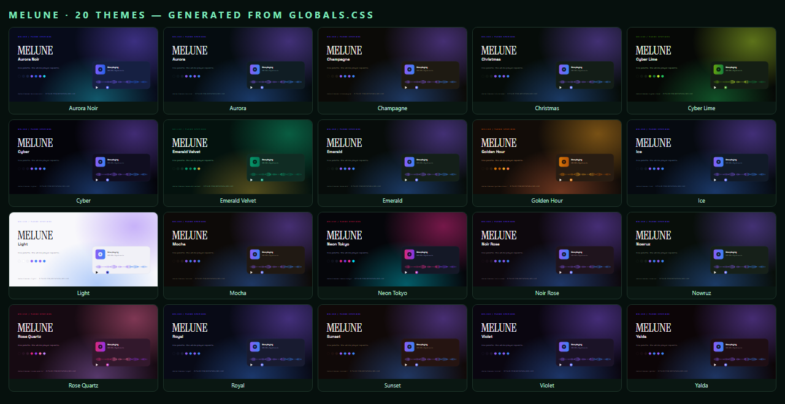
</p>
<p align="center"><sub>۲۰ پالت تم، تولیدشده از <code>globals.css</code> · <a href="docs/assets/melune-themes-all.png">اسکرینشات کامل ۲۱ تم</a></sub></p>

<p align="center">
  <a href="docs/assets/themes/index.html">۲۰ جلد تم قابلویر را ببینید →</a>
  <sub>(با <code>npm run covers:themes</code> بازتولید میشوند)</sub>
</p>

## 🎨 گالری جلدها

چهرهٔ عمومی MELUNE مجموعهای از ۱۲ جلد ۱۲۸۰×۶۴۰ است. جلد بالا **Emerald Editorial**،
**Persian Miniature** جهت فرهنگی ایرانی و **Analog Cassette** همخوان با دورهٔ کاتالوگ
دموست. هر جلد هم SVG قابلویر (با فونت جاسازیشده) و هم رندر PNG دارد.

<table>
<tr>
<td align="center"><a href="docs/assets/melune-social-cover.svg">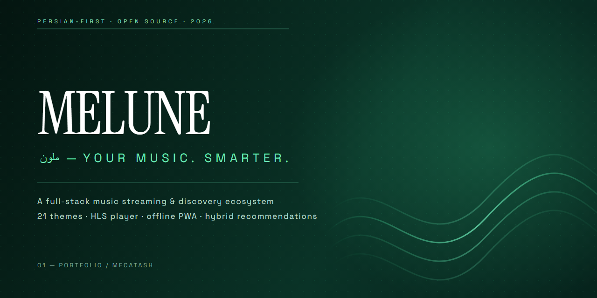</a><br /><sub><b>Emerald Editorial</b></sub></td>
<td align="center"><a href="docs/assets/melune-cover-persian-miniature.svg">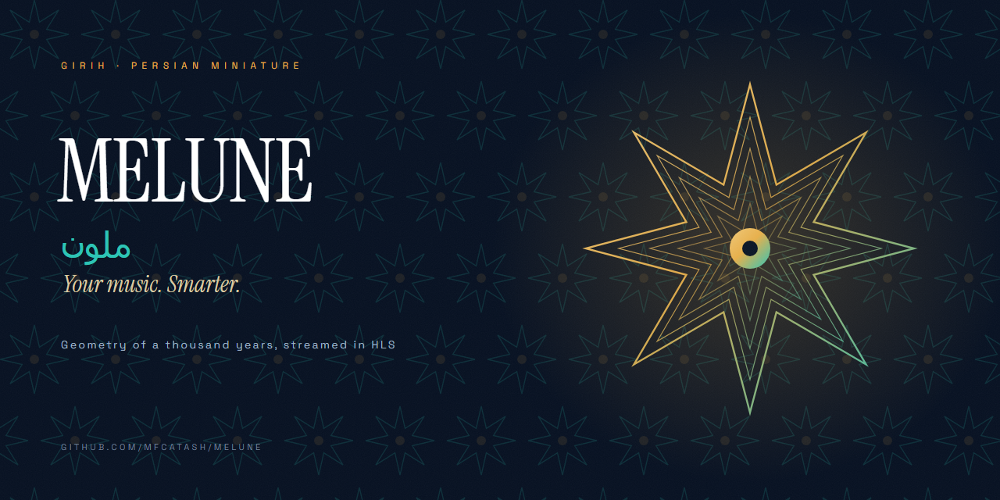</a><br /><sub><b>Persian Miniature</b></sub></td>
</tr>
<tr><td colspan="2">&nbsp;</td></tr>
<tr>
<td align="center"><a href="docs/assets/melune-cover-analog-cassette.svg">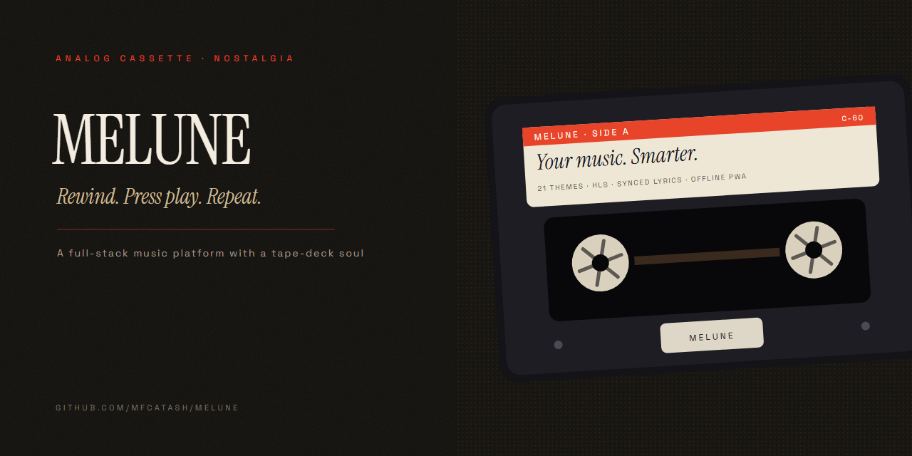</a><br /><sub><b>Analog Cassette</b></sub></td>
<td align="center"><a href="docs/assets/melune-cover-spectrum-glass.svg">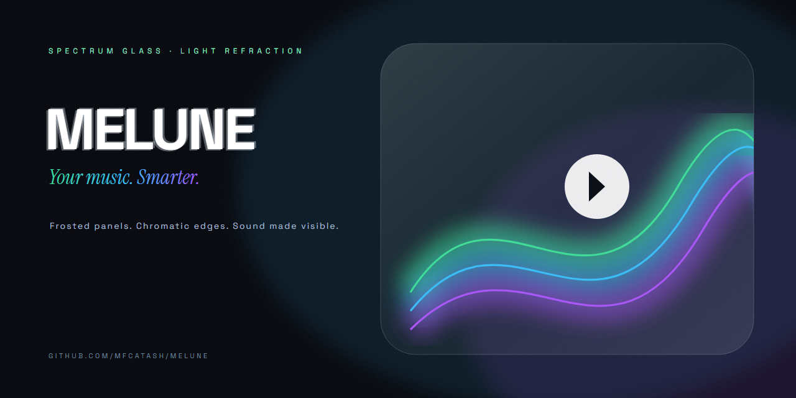</a><br /><sub><b>Spectrum Glass</b></sub></td>
</tr>
<tr><td colspan="2">&nbsp;</td></tr>
<tr>
<td align="center"><a href="docs/assets/melune-cover-brutalist-grid.svg">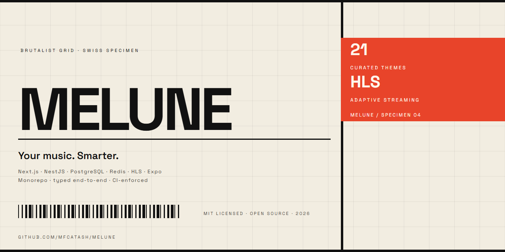</a><br /><sub><b>Brutalist Grid</b></sub></td>
<td align="center"><a href="docs/assets/melune-cover-neon-vinyl.png">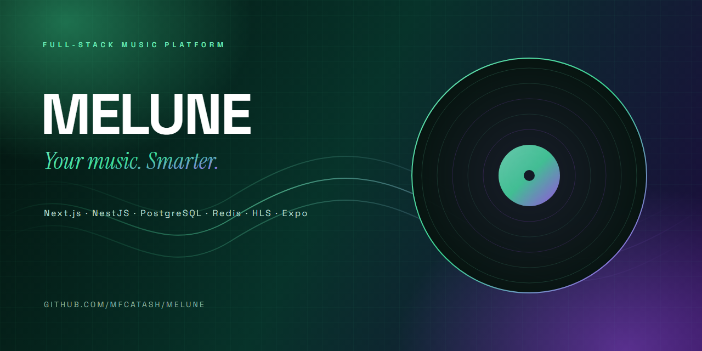</a><br /><sub><b>Neon Vinyl</b></sub></td>
</tr>
<tr><td colspan="2">&nbsp;</td></tr>
<tr>
<td align="center"><a href="docs/assets/melune-cover-aurora-glass.png">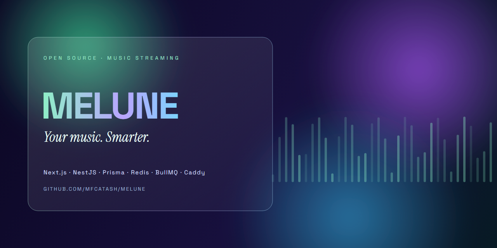</a><br /><sub><b>Aurora Glass</b></sub></td>
<td align="center"><a href="docs/assets/melune-cover-persian-noir.png">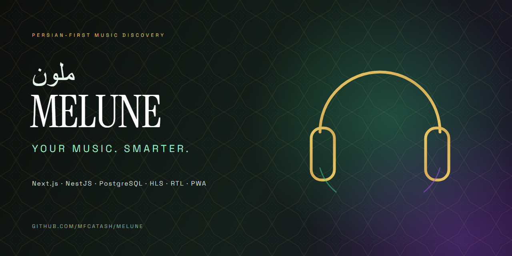</a><br /><sub><b>Persian Noir</b></sub></td>
</tr>
<tr><td colspan="2">&nbsp;</td></tr>
<tr>
<td align="center"><a href="docs/assets/melune-cover-golden-hour.svg">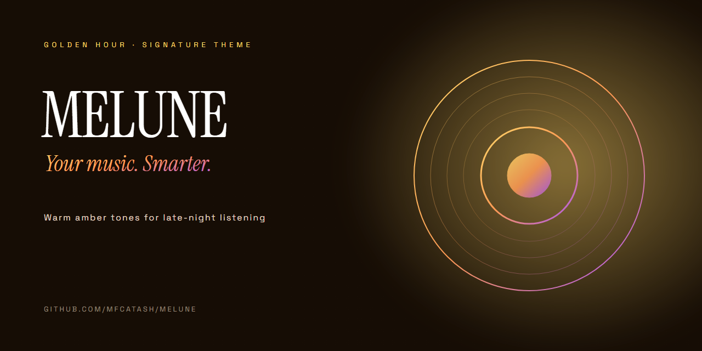</a><br /><sub><b>Golden Hour</b></sub></td>
<td align="center"><a href="docs/assets/melune-cover-cyber-lime.svg">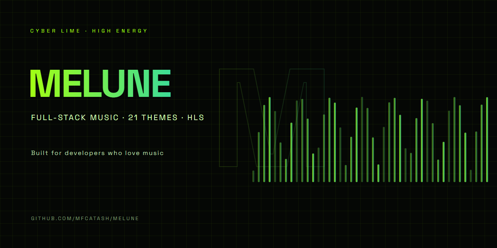</a><br /><sub><b>Cyber Lime</b></sub></td>
</tr>
<tr><td colspan="2">&nbsp;</td></tr>
<tr>
<td align="center"><a href="docs/assets/melune-cover-sonic-canvas.svg">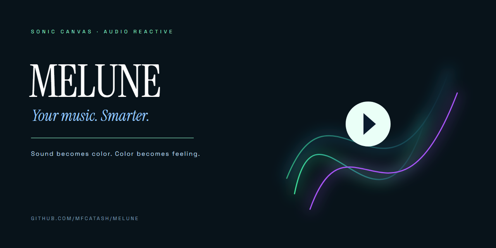</a><br /><sub><b>Sonic Canvas</b></sub></td>
<td align="center"><a href="docs/assets/melune-cover-type-stack.svg">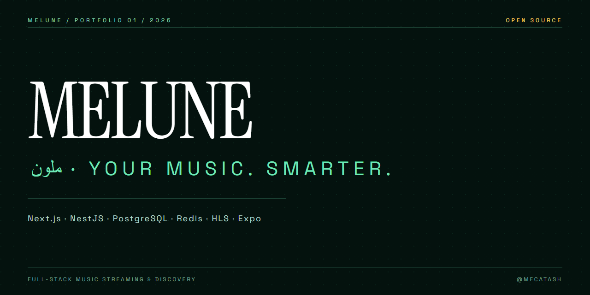</a><br /><sub><b>Type Stack</b></sub></td>
</tr>
</table>

<br />

**نوار ویژگیها** و **کارت استوری ۱۰۸۰×۱۹۲۰** برای اسلاید و شبکههای اجتماعی:

<br />

<p align="center">
  <a href="docs/assets/melune-feature-strip.svg">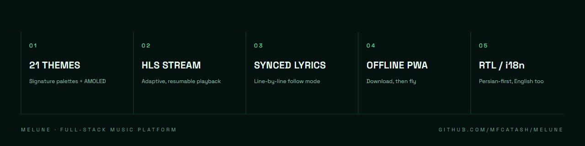</a>
</p>

<br />

<p align="center">
  <a href="docs/assets/melune-story.png">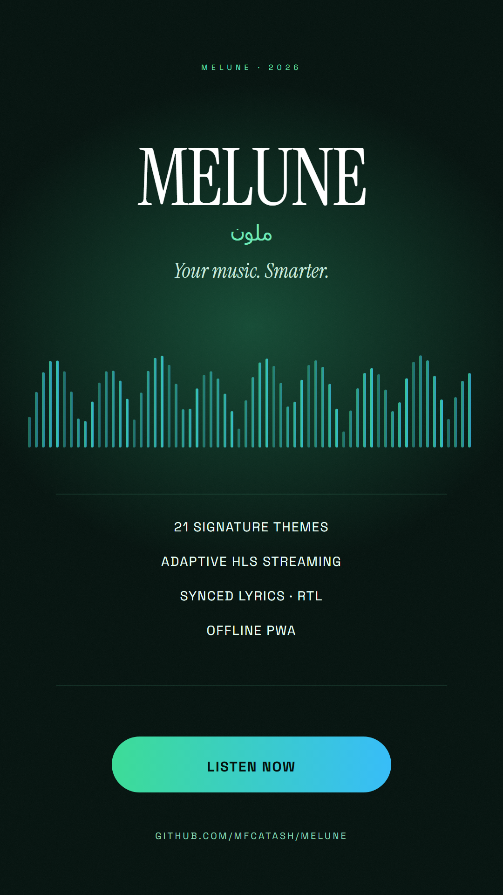</a>
</p>

<br />

---

[English README](README.md)

---

## فهرست مطالب

1. [MELUNE چیست](#melune-چیست)
2. [نقشهٔ امکانات](#نقشهٔ-امکانات)
3. [پشتهٔ فناوری](#پشتهٔ-فناوری)
4. [ساختار مخزن](#ساختار-مخزن)
5. [شروع سریع](#شروع-سریع)
6. [توسعهٔ محلی بدون Docker](#توسعهٔ-محلی-بدون-docker)
7. [استک Docker Compose](#استک-docker-compose)
8. [اسکریپت‌ها](#اسکریپتها)
9. [پیکربندی و متغیرهای محیطی](#پیکربندی-و-متغیرهای-محیطی)
10. [پایگاه‌داده، رسانه و پشتیبان‌گیری](#پایگاهداده-رسانه-و-پشتیبانگیری)
11. [تست](#تست)
12. [معماری](#معماری)
13. [استقرار در محیط تولید](#استقرار-در-محیط-تولید)
14. [وضعیت پروژه و نقشهٔ راه](#وضعیت-پروژه-و-نقشهٔ-راه)
15. [مشارکت](#مشارکت)
16. [امنیت](#امنیت)
17. [دسترسی به مخزن](#دسترسی-به-مخزن)
18. [مجوز](#مجوز)

---

## MELUNE چیست

MELUNE یک اکوسیستم پخش و کشف موسیقی است که به‌صورت یک واحد قابل استقرار ساخته شده و شامل
سه بخش اصلی می‌شود:

- **پخش‌کنندهٔ وب** (Next.js App Router) با هویت بصری متمایز — ۲۱ تم (۶ تم امضادار) و هیروی
  سه‌بعدی «Cover Flow» با پنج کاور،
- **API تایپ‌شدهٔ REST و WebSocket** (NestJS + Prisma) شامل احراز هویت، کاتالوگ، پلی‌لیست،
  لایک، تاریخچهٔ پخش، جست‌وجو، پیشنهادها، اعلان‌ها و پنل مدیریت،
- **زیرساختی که روی یک سرور کوچک جا می‌شود**: Postgres، Redis، MinIO برای صدا و کاور،
  ورکرهای BullMQ برای ترنسکد ffmpeg به HLS و Caddy به‌عنوان تنها پورت عمومی.

همهٔ بخش‌ها همراه با **محتوای نمونه و seed** ارائه می‌شوند تا پروژه بدون تنظیم اضافی اجرا شود؛
مسیرهای مستند و جداگانه‌ای برای توسعهٔ محلی، توسعهٔ کانتینری و محیط تولید وجود دارد.

---

## نقشهٔ امکانات

| حوزه | توضیح |
| --- | --- |
| تم‌بندی | ۲۱ تم، ۶ تم امضادار (Cyber Lime، Rose Quartz، Emerald Velvet، Golden Hour، Neon Tokyo، Aurora Noir)؛ مبتنی بر CSS Variables و سازگار با RTL |
| هیروی خانه | قوس سه‌بعدی Cover Flow با پنج کاور؛ منوهای تم را هرگز مسدود نمی‌کند |
| پخش‌کننده | پخش‌کنندهٔ تمام‌صفحه مبتنی بر صف، استریم HLS، دانلود آفلاین، حالت‌های Tempo و AMOLED |
| کاتالوگ | آهنگ، آلبوم، هنرمند و ژانر — مرور، فیلتر و صفحه‌بندی |
| جست‌وجو | جست‌وجوی full-text در Postgres با کش read-through |
| کتابخانه | پلی‌لیست‌ها، لایک‌ها، آیتم‌های ذخیره‌شده و تاریخچهٔ شنیدن |
| پیشنهادها | امتیازدهی ترکیبی محتوامحور + مشارکتی |
| حساب‌ها | JWT ایمیل/رمز عبور (access token + refresh cookie)، نقش‌ها (کاربر/مدیر)، مدیریت پروفایل |
| مدیریت | ویرایش کاتالوگ، تحلیل‌ها و مدیریت کاربران |
| بلادرنگ | حضور پخش با Socket.IO؛ اعلان‌های Web Push |
| رسانه | آپلود presigned روی S3 (MinIO محلی، R2/S3 در تولید)، کلیدهای UUID و کش تغییرناپذیر |
| ترنسکد | ورکر ffmpeg با خروجی HLS در سه کیفیت (128k/192k/320k) |
| موبایل | کلاینت Expo/React Native با استفاده از کلاینت API مشترک |

---

## پشتهٔ فناوری

| لایه | فناوری | پورت |
| --- | --- | --- |
| وب | Next.js 14 (App Router)، React 18، Tailwind CSS | `3000` |
| API | NestJS 10، Prisma ORM، Passport JWT، Socket.IO، BullMQ | `4000` |
| پایگاه‌داده | PostgreSQL 16 | `5432` |
| کش/صف | Redis 7 (نشست، محدودسازی نرخ، کش جست‌وجو، صف‌ها) | `6379` |
| ذخیره‌سازی | MinIO (سازگار با S3) پشت یک هاست عمومی | `9000` |
| لبه | Caddy 2.8 (TLS، reverse proxy، کش دارایی‌های استاتیک) | `80` / `443` |
| ورکر | Node + ffmpeg (`audio-transcode.worker.ts`) | داخلی |
| مشترک | `packages/types` و `packages/api-client` (کلاینت تایپ‌شده برای وب و موبایل) | — |
| موبایل | Expo SDK 51 / React Native | `8081` |
| ابزار | npm workspaces، ESLint، Jest، Playwright، GitHub Actions CI/CD | — |

---

## ساختار مخزن

```
apps/
  web/                 کلاینت Next.js (خانه، جست‌وجو، کتابخانه، آهنگ، آلبوم، هنرمند،
                       ژانر، پلی‌لیست، مدیریت، ورود، onboarding)
  api/                 API مبتنی بر NestJS (auth، catalog، search، playlists، likes،
                       history، recommendations، discover، notifications، analytics،
                       admin، storage/uploads، push، mail، queue/workers)
  mobile/              کلاینت Expo / React Native
packages/
  types/               تایپ‌های دامنهٔ مشترک (Song، Album، Artist، Genre، ...)
  api-client/          لایهٔ fetch تایپ‌شده برای وب و موبایل
  config/eslint-base.js پیش‌تنظیم مشترک ESLint
services/
  ai/                  سرویس اختیاری FastAPI: `/health` و `/recommend`
infra/
  docker/              Dockerfile هر سرویس (web، api، worker، ai)
  caddy/               Caddyfile (Let's Encrypt)، Caddyfile.origin (گواهی Cloudflare) و site.caddy
docs/                  architecture.md، api.md، database.md، design-system.md،
                       development.md، deployment.md، deploy-oracle-cloudflare.md،
                       deploy-oracle-cloudflare-fa.md (راهنمای کامل فارسی)،
                       project-analysis-fa.md (تحلیل فنی)، ai.md، lockfile.md،
                       changelog/ (یادداشت‌های فازها)
scripts/               ابزار مخزن + اسکریپت‌های استقرار (scripts/deploy/)
.env.example           قالب پیکربندی توسعه
.env.production.example قالب پیکربندی تولید
docker-compose.yml     استک توسعهٔ کانتینری
docker-compose.prod.yml استک تولید (یک VM، تنها Caddy پورت منتشر می‌کند)
.github/workflows/     ci.yml، lockfile.yml، deploy.yml
start-melune.ps1       اجرای یک‌مرحله‌ای در ویندوز
stop-melune.ps1        توقف سرویس‌ها
```

هر workspace README اختصاصی خود را دارد: [`apps/web`](apps/web/README.md)،
[`apps/api`](apps/api/README.md)، [`apps/mobile`](apps/mobile/README.md)،
[`packages/types`](packages/types/README.md)،
[`packages/api-client`](packages/api-client/README.md)،
[`services/ai`](services/ai/README.md).

---

## شروع سریع

پیش‌نیازها: **Node.js >= 20**، **PostgreSQL 16** و **Redis**. سریع‌ترین راه، استفاده از
Docker Compose است:

```bash
# ۱. دریافت کد
git clone https://github.com/MFCAtash/MELUNE.git
cd MELUNE

# ۲. نصب وابستگی‌ها
npm ci

# ۳. ساخت فایل محیطی
cp .env.example .env

# ۴. اجرای کل استک توسعه
npm run docker:up
```

سپس:

- وب: <http://localhost:3000>
- API: <http://localhost:4000/api> (سلامت: `/api/health`)

### حساب‌های آزمایشی (دادهٔ seed توسعه)

| ایمیل | رمز عبور | نقش |
| --- | --- | --- |
| `admin@melune.app` | `melune12345` | مدیر |
| `demo@melune.app` | `melune12345` | کاربر |

> این حساب‌ها را پیش از هر انتشار عمومی حذف کنید.

### اجرای یک‌مرحله‌ای در ویندوز

اگر PostgreSQL و Redis را به‌صورت محلی نصب کرده‌اید:

```powershell
Copy-Item .env.example .env
npm run prisma:migrate --workspace=apps/api
powershell -ExecutionPolicy Bypass -File .\start-melune.ps1
```

برای توقف: `.\stop-melune.ps1`.

---

## توسعهٔ محلی بدون Docker

```bash
npm ci
cp .env.example .env                          # در صورت نیاز DATABASE_URL / REDIS_URL را تنظیم کنید
npm run prisma:generate --workspace=apps/api
npm run prisma:migrate --workspace=apps/api   # فقط به جلو (forward only)
npm run dev:api                               # NestJS watch روی :4000
npm run dev:web                               # Next dev روی :3000
```

دستورهای مشترک در `package.json` ریشه تعریف شده‌اند و با `--workspace=<name>` می‌توانید
یک اپ یا پکیج مشخص را هدف بگیرید.

---

## استک Docker Compose

| فایل | کاربرد | نکته |
| --- | --- | --- |
| `docker-compose.yml` | **توسعهٔ** کانتینری | api، web، postgres، redis، minio، ai، worker؛ hot reload با mount سورس |
| `docker-compose.prod.yml` | **تولید** | تنها Caddy پورت منتشر می‌کند؛ بقیه روی شبکهٔ داخلی می‌مانند |

```bash
# توسعه
npm run docker:up
npm run docker:down

# تولید (روی سرور)
./scripts/deploy/configure-domain.sh music.example.com   # ساخت .env.production
docker compose --env-file .env.production -f docker-compose.prod.yml up -d --build
```

جزئیات بیشتر: [docs/development.md](docs/development.md) و
[docs/deployment.md](docs/deployment.md).

---

## اسکریپت‌ها

| دستور | کاربرد |
| --- | --- |
| `npm run dev:web` / `dev:api` | اجرای یک اپ در حالت watch |
| `npm run build` | بیلد همهٔ workspaceها |
| `npm run typecheck` | `tsc --noEmit` روی همهٔ workspaceها |
| `npm run lint` | لینت همهٔ workspaceها |
| `npm run test` | تست‌های واحد (API با Jest) |
| `npm run prisma:migrate` | ساخت/اعمال migration در توسعه |
| `npm run prisma:generate` | بازتولید Prisma Client |
| `npm run generate:vapid` | تولید جفت‌کلید VAPID برای Web Push |
| `npm run docker:up` / `docker:down` | چرخهٔ Compose توسعه |
| `node scripts/check-lockfile.mjs` | اعتبارسنجی سازگاری `package-lock.json` |

اسکریپت‌های استقرار در `scripts/deploy/`:

| اسکریپت | کاربرد |
| --- | --- |
| `oracle-bootstrap.sh` | آماده‌سازی اولیهٔ سرور (Docker، swap، فایروال، fail2ban) |
| `configure-domain.sh` | ساخت `.env.production` با رمزهای تصادفی و انتخاب Caddyfile مناسب |
| `fix-media-urls.sh` | بازنویسی آدرس‌های مدیای localhost به هاست تولید |

---

## پیکربندی و متغیرهای محیطی

توسعه: `.env.example` را به `.env` کپی کنید. تولید: از `.env.production.example` استفاده
کنید (یا `scripts/deploy/configure-domain.sh` که آن را خودکار پر می‌کند). هرگز این فایل‌ها
را commit نکنید — `.env` و `.env.*` در `.gitignore` هستند (به‌جز دو قالب نمونه).

متغیرهای کلیدی:

| متغیر | معنا |
| --- | --- |
| `DATABASE_URL` | رشتهٔ اتصال PostgreSQL (در Compose باید `postgres` باشد) |
| `REDIS_URL` | رشتهٔ اتصال Redis (`redis://redis:6379` در Compose) |
| `JWT_ACCESS_SECRET` | حداقل ۳۲ کاراکتر؛ در استارتاپ اعتبارسنجی می‌شود |
| `JWT_ACCESS_EXPIRES_IN` / `JWT_REFRESH_EXPIRES_IN` | قالب TTL: `15m`، `30d` |
| `CORS_ORIGIN` | یک مبدأ یا فهرست جداشده با کاما؛ هر مقدار باید URL مطلق باشد |
| `NEXT_PUBLIC_SITE_URL` | آدرس مطلق سایت برای metadata، sitemap و OpenGraph |
| `NEXT_PUBLIC_API_URL` | برای استقرار same-origin خالی بگذارید |
| `API_INTERNAL_URL` | آدرس داخلی API در شبکهٔ Docker (`http://api:4000`) |
| `STORAGE_ENDPOINT` / `STORAGE_PUBLIC_URL` | نقطهٔ پایانی S3 و پیشوند عمومی آبجکت‌ها |
| `STORAGE_BUCKET` | نام باکت (پیش‌فرض `melune-music`) |
| `DOMAIN` / `MEDIA_DOMAIN` | هاست اپ و هاست رسانه (هاست رسانه باید یک سطح زیردامنه باشد) |
| `CADDYFILE` | `Caddyfile` (Let's Encrypt) یا `Caddyfile.origin` (گواهی Cloudflare) |
| `MAIL_FROM` | آدرس فرستنده؛ روی ناحیهٔ apex نگه دارید |
| `VAPID_PUBLIC_KEY` / `VAPID_PRIVATE_KEY` | Web Push؛ تنظیم تنها یکی در بوت رد می‌شود |
| `TRANSCODE_WORKER_CONCURRENCY` | موازی‌سازی ffmpeg روی ورکر |
| `HYBRID_CONTENT_WEIGHT` / `HYBRID_COLLABORATIVE_WEIGHT` | ترکیب پیشنهادها (مجموع حدود ۱) |

اعتبارسنجی استارتاپ در `apps/api/src/config/env.validation.ts` قرار دارد: نبودِ secretها
باعث خطای سریع می‌شود، نه بوت بی‌صدا با رفتار خراب.

---

## پایگاه‌داده، رسانه و پشتیبان‌گیری

- **اسکیما:** migrationهای Prisma در `apps/api/prisma/migrations`؛ اسکیما مرجع است.
  Migrationها فقط به جلو حرکت می‌کنند — پیش از هر استقرار مؤثر بر داده، پشتیبان بگیرید.
- **محتوای نمونه:** ۹۰ آهنگ و ۱۵ آلبوم، شامل ۱۲ آهنگ کامل از
  `apps/web/public/audio-full/` و پنج کاور منتخب هیرو.
- **رسانه:** آپلودها با کلید UUID در ذخیره‌سازی سازگار با S3 ذخیره می‌شوند، دسترسی
  عمومی و کش تغییرناپذیر (`Cache-Control: max-age=31536000, immutable`).
- **بازیابی پایگاه‌دادهٔ نمونه:**
  ```powershell
  .\.infra\pgsql16\bin\pg_restore.exe -h localhost -p 5432 -U melune `
    -d melune_music --clean --if-exists .\.db-backup\melune.dump
  ```
  سپس بازنویسی آدرس‌ها: `./scripts/deploy/fix-media-urls.sh --apply`

---

## تست

| سطح | روش |
| --- | --- |
| Typecheck | `npm run typecheck` |
| Lint | `npm run lint` |
| واحد (API) | `npm run test` |
| یکپارچه (API) | `npm run test:e2e --workspace=apps/api` |
| E2E وب | `npm run test:e2e --workspace=apps/web` (Playwright) |
| CI | `.github/workflows/ci.yml` |

---

## معماری

```
        ┌────────────┐        ┌──────────────┐
        │  Next.js   │◄──────►│   NestJS API │
        │  (web)     │  REST  │  + Socket.IO │
        └────────────┘        └──────┬───────┘
                                      │
                 ┌────────────────────┼────────────────────┐
                 ▼                    ▼                    ▼
           ┌──────────┐        ┌───────────┐        ┌──────────┐
           │ Postgres │        │   Redis   │        │  MinIO   │
           │ (Prisma) │        │ cache/que │        │  (S3)    │
           └──────────┘        └─────┬─────┘        └──────────┘
                                      │
                                ┌─────▼─────┐
                                │  BullMQ   │
                                │  worker   │──► ffmpeg ──► HLS
                                └───────────┘

        Caddy (TLS + reverse proxy) تنها پورت عمومی: 80/443
```

توضیح کامل: [docs/architecture.md](docs/architecture.md).
فهرست کامل اسناد: [docs/README.md](docs/README.md).

---

## استقرار در محیط تولید

مسیر پیشنهادی، یک VM لینوکسی با Docker است:

```bash
# روی سرور
git clone https://github.com/MFCAtash/MELUNE.git /opt/melune
cd /opt/melune
sudo ./scripts/deploy/oracle-bootstrap.sh
./scripts/deploy/configure-domain.sh music.example.com
docker compose --env-file .env.production -f docker-compose.prod.yml up -d --build
```

- گردش‌کار CI/CD در `.github/workflows/deploy.yml` تعریف شده و با secretهای
  `DEPLOY_SSH_KEY`، `DEPLOY_USER`، `DEPLOY_PATH` و `DEPLOY_PORT` کار می‌کند.
- راهنمای گام‌به‌گام: [docs/deployment.md](docs/deployment.md) و
  [docs/deploy-oracle-cloudflare.md](docs/deploy-oracle-cloudflare.md).
- [راهنمای کامل فارسی استقرار](docs/deploy-oracle-cloudflare-fa.md) — چکلیست مستقل از ساخت VM تا بکاپ و عیبیابی.

---

## وضعیت پروژه و نقشهٔ راه

- ✅ وب، API، موبایل، ورکر ترنسکد و سرویس AI
- ✅ احراز هویت، کاتالوگ، پلی‌لیست، جست‌وجو، پیشنهادها، اعلان‌ها و پنل مدیریت
- ✅ استک تولید با Caddy و پشتیبان‌گیری
- ⏳ ارسال ایمیل واقعی (سرویس Mail هنوز stub است)
- ⏳ حذف حساب‌های نمایشی پیش از انتشار عمومی
- ⏳ گسترش پوشش تست E2E

تاریخچهٔ تغییرات: [CHANGELOG.md](CHANGELOG.md) و
[آرشیو تغییرات](docs/changelog/README.md).

اسناد تکمیلی: [معماری](docs/architecture.md)، [پایگاه داده](docs/database.md)،
[طراحی رابط](docs/design-system.md)، [تحلیل فنی جامع](docs/project-analysis-fa.md) و
[راهنمای دسترسی به مخزن](docs/github-access.md).

---

## مشارکت

پیش از ارسال Pull Request، [CONTRIBUTING.md](CONTRIBUTING.md) و
[CODE_OF_CONDUCT.md](CODE_OF_CONDUCT.md) را بخوانید. خلاصه:

1. یک branch از `main` بسازید.
2. `npm run lint && npm run typecheck && npm run test` را اجرا کنید.
3. برای تغییرات رفتاری، تست اضافه کنید.
4. از قالب Pull Request استفاده کنید.

---

## امنیت

برای گزارش آسیب‌پذیری، لطفاً مسئولانه عمل کنید: [SECURITY.md](SECURITY.md).
هیچ secret یا فایل `.env` را در مخزن قرار ندهید. CI شامل بررسی lockfile و اسکن سادهٔ
secret است.

---

## دسترسی به مخزن

جزئیات کامل نقش‌ها و روش دعوت کاربر با دسترسی فقط-خواندن:
[docs/github-access.md](docs/github-access.md).

> **نکتهٔ مهم:** در یک مخزن **عمومی**، کد برای همه قابل مشاهده و دانلود است و GitHub
> امکان «مشاهده بدون امکان کپی» را ارائه نمی‌دهد. برای محدودکردن دسترسی، مخزن باید
> خصوصی باشد.

اسکریپت دعوت با نقش `pull` (کمترین سطح دسترسی موجود):

```bash
./scripts/github/grant-read-access.sh --list
./scripts/github/grant-read-access.sh reader@example.com
```

---

## مجوز

[MIT](LICENSE) © 2026 MELUNE
