<div align="center">

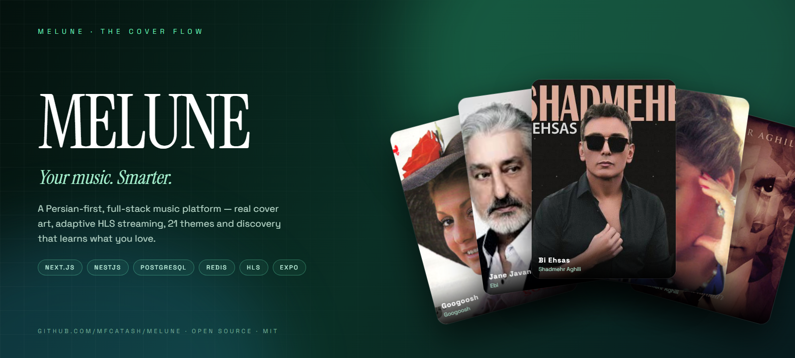

</div>

<br />

<p align="center"><sub>Cover Flow — the actual album and artist artwork shipped with MELUNE</sub></p>

<br />

# MELUNE

**MELUNE — Your Music. Smarter.**

A Persian-first, full-stack music streaming and discovery platform: a Next.js
web player, a NestJS REST/WebSocket API, PostgreSQL + Prisma, Redis, an ffmpeg
HLS transcode worker, an Expo mobile client and an optional FastAPI recommender
— all in one typed TypeScript monorepo.

The artwork above is the **real catalogue shipped with the project** (Googoosh,
Ebi, Shadmehr Aghili, Hayedeh…), arranged exactly like the app's Cover Flow.
The screenshots below are from the running product — not mockups.

<br />

<p align="center">

[](https://github.com/MFCAtash/MELUNE/actions/workflows/ci.yml)
[](https://github.com/MFCAtash/MELUNE/releases)
[](LICENSE)
[](apps/api/coverage/lcov-report/index.html)
[](package.json)
[](#tech-stack)
[](#tech-stack)

</p>

<br />

## 🖼 MELUNE in pictures

Before the technical details, here is what the product actually looks like.
**Twenty-one themes** repaint the entire shell — surfaces, brand gradient,
halos and glows — while the per-track ambient color follows the artwork being
played. The full-screen player adds an audio-reactive Sonic Canvas, synced
lyrics, a real waveform seek bar, focus mode, sleep timer and a share card.

<p align="center">
  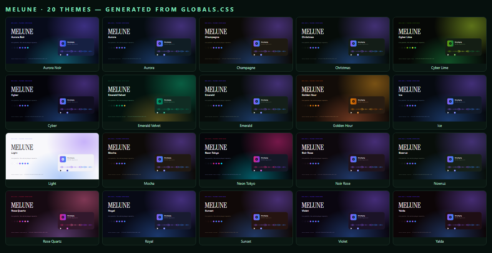
</p>
<p align="center"><sub>Twenty theme palettes, generated from <code>globals.css</code> · <a href="docs/assets/melune-themes-all.png">full 21-theme screenshot</a></sub></p>

<p align="center">
  <a href="docs/assets/themes/index.html">Open the 20 editable theme cover cards →</a>
  <sub>(regenerate with <code>npm run covers:themes</code>)</sub>
</p>

## 🎨 Cover gallery

MELUNE's public face is a set of twelve 1280×640 cover concepts. The hero uses
**Emerald Editorial**; **Persian Miniature** is the culturally-specific
direction; **Analog Cassette** matches the era of the demo catalogue. Every
card is an editable SVG with embedded fonts plus a PNG render.

<table>
<tr>
<td align="center"><a href="docs/assets/melune-social-cover.svg">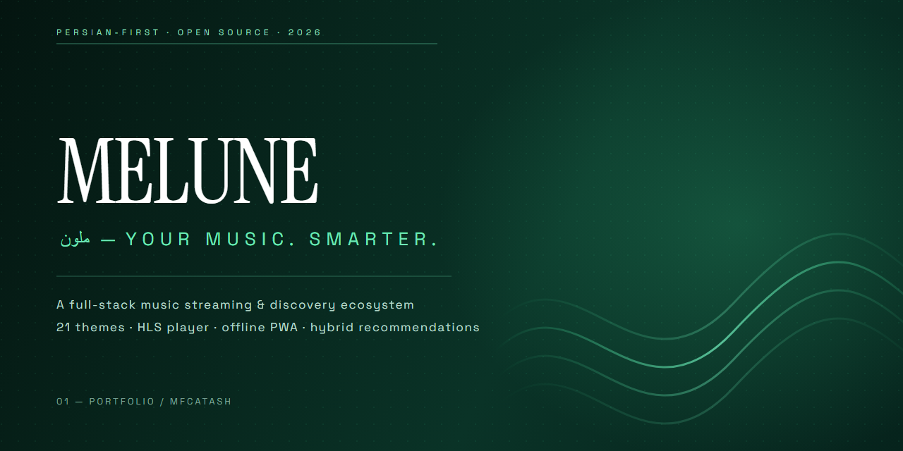</a><br /><sub><b>Emerald Editorial</b></sub></td>
<td align="center"><a href="docs/assets/melune-cover-persian-miniature.svg">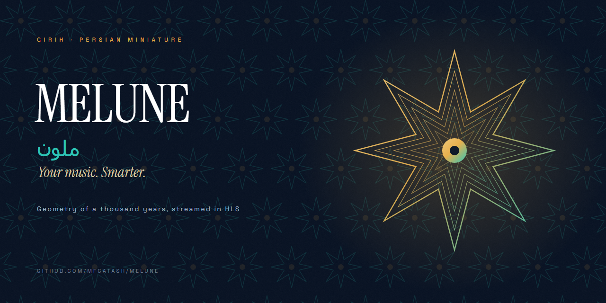</a><br /><sub><b>Persian Miniature</b></sub></td>
</tr>
<tr><td colspan="2">&nbsp;</td></tr>
<tr>
<td align="center"><a href="docs/assets/melune-cover-analog-cassette.svg">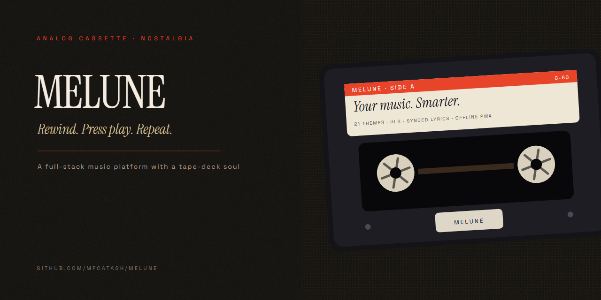</a><br /><sub><b>Analog Cassette</b></sub></td>
<td align="center"><a href="docs/assets/melune-cover-spectrum-glass.svg">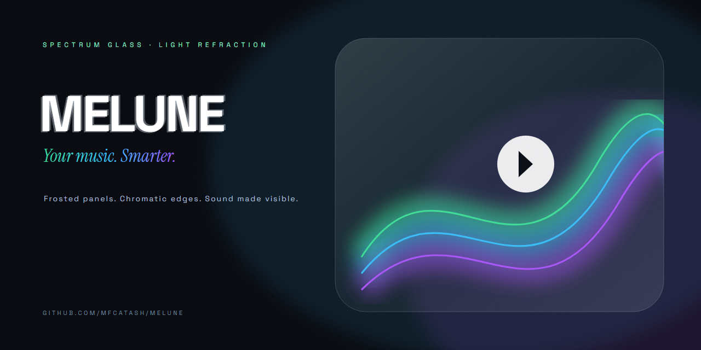</a><br /><sub><b>Spectrum Glass</b></sub></td>
</tr>
<tr><td colspan="2">&nbsp;</td></tr>
<tr>
<td align="center"><a href="docs/assets/melune-cover-brutalist-grid.svg">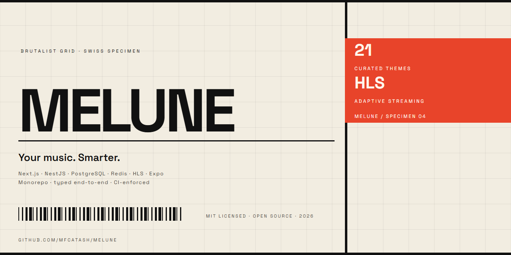</a><br /><sub><b>Brutalist Grid</b></sub></td>
<td align="center"><a href="docs/assets/melune-cover-neon-vinyl.png">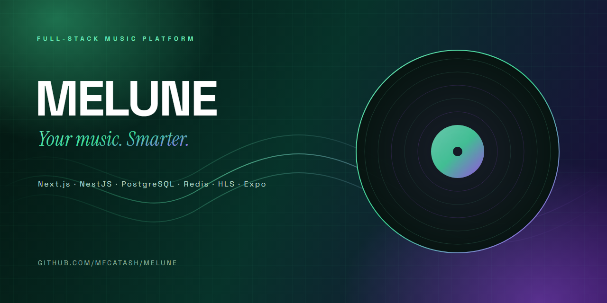</a><br /><sub><b>Neon Vinyl</b></sub></td>
</tr>
<tr><td colspan="2">&nbsp;</td></tr>
<tr>
<td align="center"><a href="docs/assets/melune-cover-aurora-glass.png">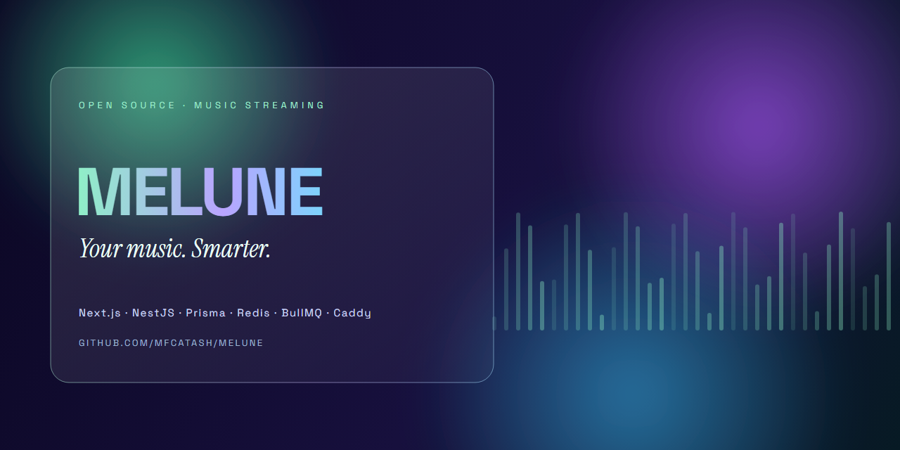</a><br /><sub><b>Aurora Glass</b></sub></td>
<td align="center"><a href="docs/assets/melune-cover-persian-noir.png">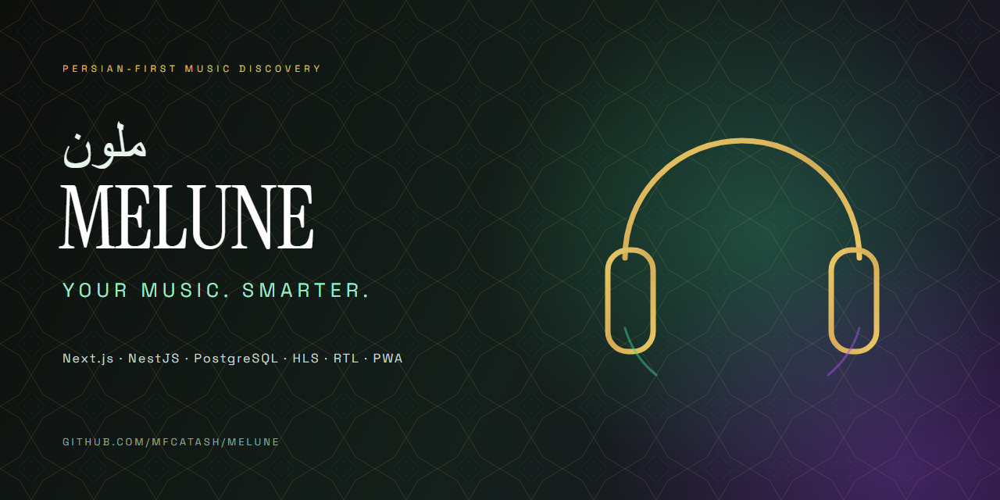</a><br /><sub><b>Persian Noir</b></sub></td>
</tr>
<tr><td colspan="2">&nbsp;</td></tr>
<tr>
<td align="center"><a href="docs/assets/melune-cover-golden-hour.svg">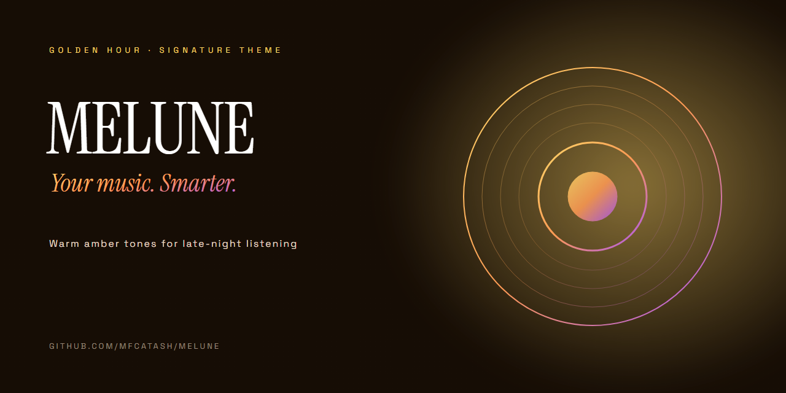</a><br /><sub><b>Golden Hour</b></sub></td>
<td align="center"><a href="docs/assets/melune-cover-cyber-lime.svg">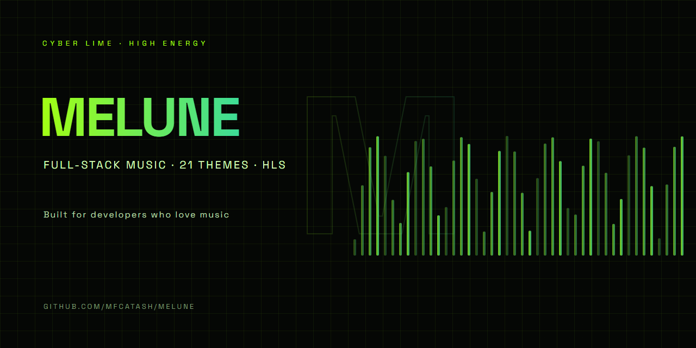</a><br /><sub><b>Cyber Lime</b></sub></td>
</tr>
<tr><td colspan="2">&nbsp;</td></tr>
<tr>
<td align="center"><a href="docs/assets/melune-cover-sonic-canvas.svg">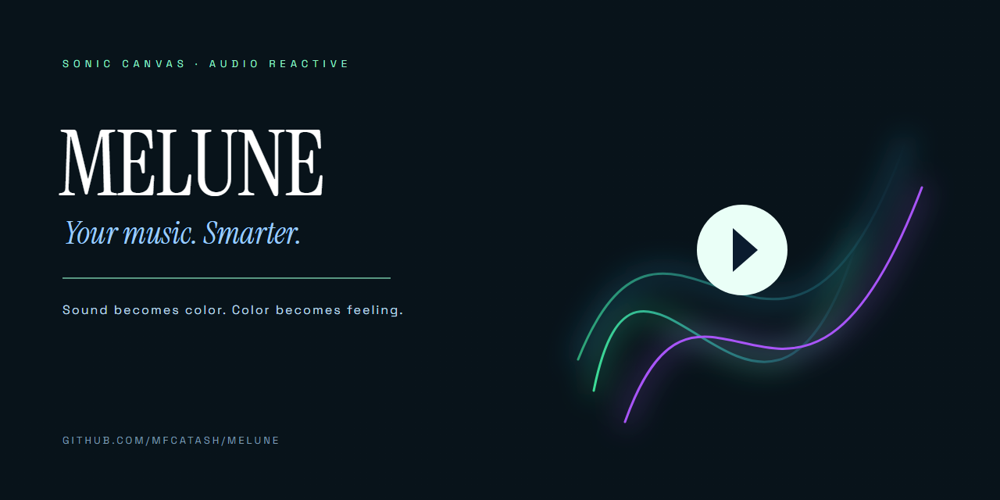</a><br /><sub><b>Sonic Canvas</b></sub></td>
<td align="center"><a href="docs/assets/melune-cover-type-stack.svg">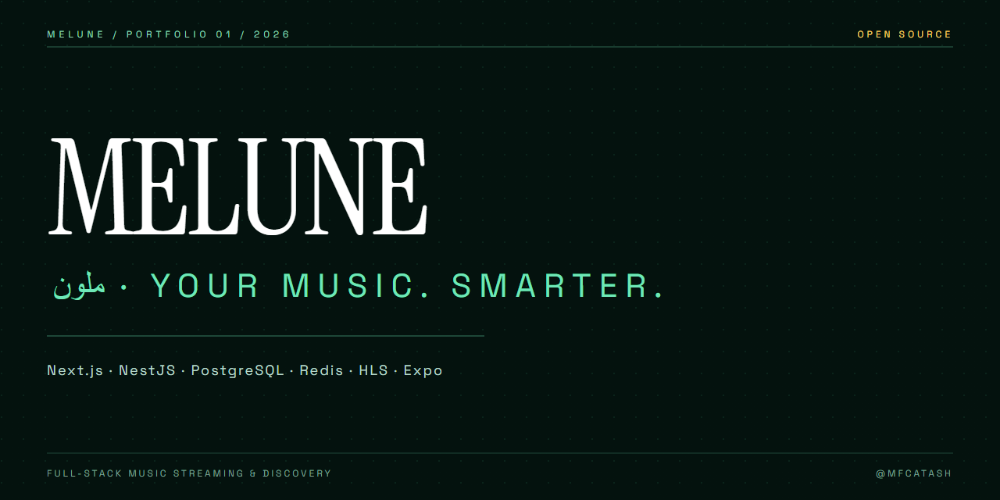</a><br /><sub><b>Type Stack</b></sub></td>
</tr>
</table>

<br />

**Feature strip** and **1080×1920 story card** for reuse in slides and social
posts:

<br />

<p align="center">
  <a href="docs/assets/melune-feature-strip.svg">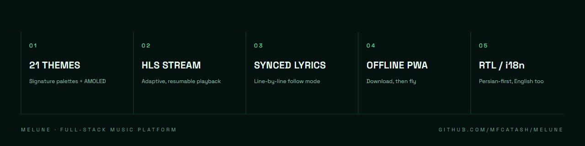</a>
</p>

<br />

<p align="center">
  <a href="docs/assets/melune-story.png">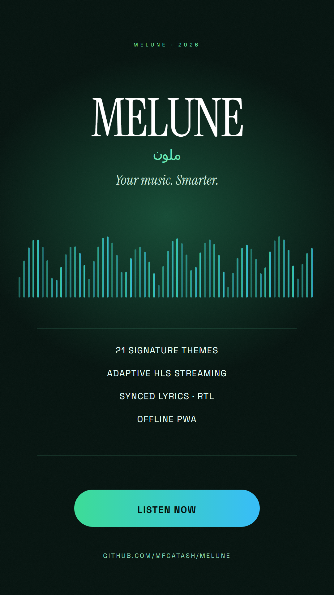</a>
</p>

<br />

---

## Table of contents

1. [What MELUNE is](#what-melune-is)
2. [Feature map](#feature-map)
3. [Tech stack](#tech-stack)
4. [Repository layout](#repository-layout)
5. [Quick start (Windows)](#quick-start-windows)
6. [Local development without Docker](#local-development-without-docker)
7. [Docker Compose stack](#docker-compose-stack)
8. [Scripts](#scripts)
9. [Configuration & environment variables](#configuration--environment-variables)
10. [Database, media and backups](#database-media-and-backups)
11. [Testing](#testing)
12. [Architecture](#architecture)
13. [Production deployment](#production-deployment)
14. [Project status & roadmap](#project-status--roadmap)
15. [Contributing](#contributing)
16. [Security](#security)
17. [Repository access](#repository-access)
18. [License](#license)

---

## What MELUNE is

MELUNE is a music streaming and discovery ecosystem built as a single deployable
unit. It combines:

- a **web player** (Next.js App Router) with a distinctive visual identity —
  six signature themes and a five-cover "cover flow" hero,
- a **typed REST + WebSocket API** (NestJS + Prisma) covering auth, catalog,
  playlists, likes, history, search, recommendations, notifications and admin,
- **infrastructure that fits on one small server**: Postgres, Redis, MinIO for
  audio/covers, BullMQ workers for ffmpeg transcoding to HLS, and Caddy as the
  only public port.

Everything ships with **seed/demo content** so the app runs out of the box, and
there are separate, documented paths for local development, containerised
development and production.

---

## Feature map

| Area | Detail |
| --- | --- |
| Theming | 21 themes, 6 signature (Cyber Lime, Rose Quartz, Emerald Velvet, Golden Hour, Neon Tokyo, Aurora Noir); CSS-variable driven, RTL-aware |
| Home hero | Five-cover 3D cover-flow arc; never blocks theme menus (stacking contexts isolated) |
| Player | Queue-based full-screen player, HLS streaming, offline downloads, tempo & AMOLED modes |
| Catalog | Songs, albums, artists, genres — browse, filter, paginated |
| Search | Full-text Postgres search with a read-through cache |
| Library | Playlists, likes, saved items, listening history |
| Recommendations | Hybrid content + collaborative scoring |
| Accounts | Email/password JWT (access token + refresh cookie), roles (user/admin), profile management |
| Admin | Catalog editor, analytics, user management |
| Realtime | Socket.IO playback presence; Web Push notifications |
| Media | Presigned S3 uploads (MinIO locally, R2/S3-compatible in production), UUID keys, immutable caching |
| Transcoding | ffmpeg worker producing HLS renditions (128k/192k/320k) |
| Mobile | Expo/React Native client sharing the typed API client |

---

## Tech stack

| Layer | Technology | Port |
| --- | --- | --- |
| Web | Next.js 14 (App Router), React 18, Tailwind CSS | `3000` |
| API | NestJS 10, Prisma ORM, Passport JWT, Socket.IO, BullMQ | `4000` |
| Database | PostgreSQL 16 | `5432` |
| Cache/Queue | Redis 7 (sessions, throttling, search cache, queues) | `6379` |
| Storage | MinIO (S3-compatible) behind a public host | `9000` |
| Edge | Caddy 2.8 (TLS, reverse proxy, static asset caching) | `80` / `443` |
| Worker | Node + ffmpeg (`audio-transcode.worker.ts`) | internal |
| Shared | `packages/types`, `packages/api-client` (typed endpoints for web + mobile) | — |
| Mobile | Expo SDK 51 / React Native | `8081` |
| Tooling | pnpm-style npm workspaces, ESLint, Jest, Playwright traces ignored, GitHub Actions CI/CD | — |

---

## Repository layout

```
apps/
  web/                 Next.js client (home, search, library, song, album, artist,
                       genre, playlist, admin, auth, onboarding)
  api/                 NestJS API (auth, catalog, search, playlists, likes, history,
                       recommendations, discover, notifications, analytics, admin,
                       storage/uploads, push, mail, queue/workers)
  mobile/              Expo / React Native client
packages/
  types/               Shared domain types (Song, Album, Artist, Genre, ...)
  api-client/          Typed fetch wrapper used by both web and mobile
  config/eslint-base.js Shared ESLint preset
services/
  ai/                  Optional FastAPI service: /health and /recommend
infra/
  docker/              Per-service Dockerfiles (web, api, worker, ai)
  caddy/               Caddyfile (Let's Encrypt), Caddyfile.origin (Cloudflare
                       Origin Certificate) and site.caddy (shared routes/headers)
docs/                  architecture.md, api.md, database.md, design-system.md,
                       development.md, deployment.md, deploy-oracle-cloudflare.md,
                       deploy-oracle-cloudflare-fa.md (Persian), project-analysis-fa.md,
                       ai.md, lockfile.md, changelog/ (phase notes)
scripts/               Repo tooling + deployment helpers (see scripts/deploy/)
.env.example           Development configuration template
.env.production.example Production configuration template
docker-compose.yml     Local containerised development stack
docker-compose.prod.yml Production stack (single VM, Caddy publishes ports)
.github/workflows/     ci.yml, lockfile.yml, deploy.yml
start-melune.ps1       Windows one-shot launcher
stop-melune.ps1        Windows stop script
```

Each workspace has its own README: [`apps/web`](apps/web/README.md),
[`apps/api`](apps/api/README.md), [`apps/mobile`](apps/mobile/README.md),
[`packages/types`](packages/types/README.md),
[`packages/api-client`](packages/api-client/README.md),
[`services/ai`](services/ai/README.md).

---

## Quick start (Windows)

This machine ships PostgreSQL 16 and Redis inside `.infra/` (gitignored), so a
full local run needs **no extra installs**.

```powershell
# 1. install dependencies
npm ci

# 2. create your local env file
Copy-Item .env.example .env
# then edit DATABASE_URL if your credentials differ

# 3. apply the schema
npm run prisma:migrate --workspace=apps/api

# 4. everything at once (Postgres, Redis, API, web, opens http://localhost:3000)
powershell -ExecutionPolicy Bypass -File .\start-melune.ps1
```

To stop it: `.\stop-melune.ps1`.

**Demo accounts** (development seed data):

| Email | Password | Role |
| --- | --- | --- |
| `admin@melune.app` | `melune12345` | admin |
| `demo@melune.app` | `melune12345` | user |

> Delete these accounts before any public launch.

Health check: <http://localhost:4000/api/health>

Persian guide: [README-FA.md](README-FA.md).

---

## Local development without Docker

Prerequisites: Node.js >= 20, PostgreSQL 16, Redis.

```bash
npm ci
cp .env.example .env            # adjust DATABASE_URL / REDIS_URL if needed
npm run prisma:generate --workspace=apps/api
npm run prisma:migrate --workspace=apps/api   # applies migrations (forward only)
npm run dev:api                 # NestJS watch mode on :4000
npm run dev:web                 # Next dev server on :3000
```

Common commands live in the root `package.json` workspaces; each command accepts
`--workspace=<name>` to target a specific app or package.

---

## Docker Compose stack

Two stacks are provided:

| File | Use | Notes |
| --- | --- | --- |
| `docker-compose.yml` | Containerised **development** | api, web, postgres, redis, minio, ai, worker; hot reload via mounted sources |
| `docker-compose.prod.yml` | **Production** | Caddy is the only published port; everything else stays on an internal network |

```bash
# development
npm run docker:up          # builds + starts, then tails logs
npm run docker:down

# production (on the server)
./scripts/deploy/configure-domain.sh music.melune.app   # writes .env.production
docker compose --env-file .env.production -f docker-compose.prod.yml up -d --build
```

See [docs/development.md](docs/development.md) and
[docs/deployment.md](docs/deployment.md) for details.

---

## Scripts

| Command | Purpose |
| --- | --- |
| `npm run dev:web` / `dev:api` | Run one app in watch mode |
| `npm run build` | Build every workspace |
| `npm run typecheck` | `tsc --noEmit` across workspaces |
| `npm run lint` | Lint every workspace |
| `npm run test` | Unit tests (API uses Jest) |
| `npm run prisma:migrate` | Create/apply migrations during development |
| `npm run prisma:generate` | Regenerate the Prisma client |
| `npm run generate:vapid` | Generate Web Push VAPID key pair |
| `npm run docker:up` / `docker:down` | Compose lifecycle for development |
| `node scripts/check-lockfile.mjs` | Validate `package-lock.json` consistency |

Deployment helpers in `scripts/deploy/`:

| Script | Purpose |
| --- | --- |
| `oracle-bootstrap.sh` | First-boot VM setup (Docker, swap, firewall, fail2ban) |
| `configure-domain.sh` | Generates `.env.production` with random secrets + picks the right Caddyfile |
| `fix-media-urls.sh` | Rewrites localhost media URLs to the production media host |

---

## Configuration & environment variables

Development: copy `.env.example` → `.env`. Production: use
`.env.production.example` (or `scripts/deploy/configure-domain.sh`, which fills it
in automatically). Never commit either file — `.env` and `.env.*` are gitignored
(except the two example templates).

The critical variables:

| Variable | Meaning |
| --- | --- |
| `DATABASE_URL` | PostgreSQL connection string (host must be `postgres` in Compose) |
| `REDIS_URL` | Redis connection string (`redis://redis:6379` in Compose) |
| `JWT_ACCESS_SECRET` | Minimum 32 characters; validated at startup |
| `JWT_ACCESS_EXPIRES_IN`, `JWT_REFRESH_EXPIRES_IN` | TTL syntax: `15m`, `30d` |
| `CORS_ORIGIN` | Single origin or comma-separated list; every entry must be an absolute URL |
| `NEXT_PUBLIC_SITE_URL` | Absolute site URL baked into metadata/sitemap/OpenGraph |
| `NEXT_PUBLIC_API_URL` | Leave empty for same-origin deployments |
| `API_INTERNAL_URL` | Server-side API base inside the Docker network (`http://api:4000`) |
| `STORAGE_ENDPOINT`, `STORAGE_PUBLIC_URL` | Public S3 endpoint + public object URL prefix |
| `STORAGE_BUCKET` | Bucket name (`melune-music` by default) |
| `DOMAIN`, `MEDIA_DOMAIN` | App host and media host (media host must stay one subdomain level deep) |
| `CADDYFILE` | `Caddyfile` (Let's Encrypt) or `Caddyfile.origin` (Cloudflare Origin cert) |
| `MAIL_FROM` | Sender address; keep it on the apex zone |
| `VAPID_PUBLIC_KEY`, `VAPID_PRIVATE_KEY` | Web Push; setting only one is rejected at boot |
| `TRANSCODE_WORKER_CONCURRENCY` | ffmpeg parallelism on the worker |
| `HYBRID_CONTENT_WEIGHT`, `HYBRID_COLLABORATIVE_WEIGHT` | Recommendation blend (should sum to ~1) |

Startup validation lives in `apps/api/src/config/env.validation.ts`: missing
secrets fail fast instead of silently booting with broken behaviour.

---

## Database, media and backups

- **Schema:** Prisma migrations in `apps/api/prisma/migrations`; the schema is
  authoritative. Migrations only move forward — take a backup before any
  database-affecting deploy.
- **Seed/demo content:** 90 songs and 15 albums, including 12 full-length tracks
  served from `apps/web/public/audio-full/` and five curated hero sleeves.
- **Media:** uploads go to S3-compatible storage under UUID keys, public-read and
  immutable-cached (`Cache-Control: max-age=31536000, immutable`).
- **Restore demo database:**
  ```powershell
  .\.infra\pgsql16\bin\pg_restore.exe -h localhost -p 5432 -U melune `
    -d melune_music --clean --if-exists .\.db-backup\melune.dump
  ```
  Then rewrite stored URLs:
  `./scripts/deploy/fix-media-urls.sh --apply`

---

## Testing

| Level | How |
| --- | --- |
| Type checking | `npm run typecheck` |
| Linting | `npm run lint` |
| Unit tests (API) | `npm run test` / `npm run test:api` |
| E2E (Playwright) | `npm run test:e2e` where configured |
| Compose validation | `docker compose -f docker-compose.prod.yml config` |
| CI | `.github/workflows/ci.yml` runs on every push and pull request |
| Lockfile guard | `.github/workflows/lockfile.yml` keeps `package-lock.json` honest |

---

## Architecture

The short version: the browser talks to a single origin. In production **Caddy**
terminates TLS, serves `/` from Next.js, proxies `/api/*` and `/socket.io/*` to
NestJS, and exposes the media bucket from MinIO. Because the API, the websocket
and the media all share one origin, there is no CORS, cross-site cookie or
presigned-URL mismatch to manage.

Longer reads (full index: [docs/README.md](docs/README.md)):

- [docs/architecture.md](docs/architecture.md) — module map, request flows, realtime
- [docs/api.md](docs/api.md) — endpoint reference and conventions
- [docs/database.md](docs/database.md) — schema walkthrough, indexes, search
- [docs/design-system.md](docs/design-system.md) — themes, tokens, components
- [docs/development.md](docs/development.md) — day-to-day workflow and rules
- [docs/deploy-oracle-cloudflare-fa.md](docs/deploy-oracle-cloudflare-fa.md) — full Persian deployment checklist
- [docs/project-analysis-fa.md](docs/project-analysis-fa.md) — in-depth technical analysis (Persian)

---

## Production deployment

Option B (documented): a single Oracle Cloud Always Free VM running
`docker-compose.prod.yml`, with Cloudflare in front for DNS, TLS edge, CDN and WAF.

- **Step-by-step checklist (English):** [docs/deploy-oracle-cloudflare.md](docs/deploy-oracle-cloudflare.md)
- **راهنمای کامل فارسی:** [docs/deploy-oracle-cloudflare-fa.md](docs/deploy-oracle-cloudflare-fa.md)
- **Environment template:** [.env.production.example](.env.production.example)
- **CI/CD:** [.github/workflows/deploy.yml](.github/workflows/deploy.yml) deploys over SSH after CI succeeds on `main`, or on demand with a chosen ref/SHA
- **TLS:** [infra/caddy/Caddyfile](infra/caddy/Caddyfile) (Let's Encrypt) or
  [infra/caddy/Caddyfile.origin](infra/caddy/Caddyfile.origin) (Cloudflare Origin Certificate, recommended)
- **Bootstrap:** `scripts/deploy/oracle-bootstrap.sh`
- **Domain helper:** `scripts/deploy/configure-domain.sh`

### Deployment variables for GitHub Actions

| Secret | Value |
| --- | --- |
| `DEPLOY_SSH_KEY` | Private key for the VM |
| `DEPLOY_HOST` | VM public IP |
| `DEPLOY_USER` | `ubuntu` |
| `DEPLOY_PATH` | `/opt/melune` |
| `DEPLOY_PORT` | `22` |
| `PUBLIC_URL` (variable) | e.g. `https://music.melune.app` |

---

## Project status & roadmap

**Current status:** feature-complete demo. Auth, catalog, playback, HLS, playlists,
library, search, recommendations, admin, realtime presence and CI/CD are all
implemented and wired together.

Before a public launch:

- [ ] Replace demo/demo accounts (`admin@melune.app`, `demo@melune.app`)
- [ ] Connect a real email provider — `MailService` currently logs reset/verification emails
- [ ] Swap licensed sample media for properly licensed content
- [ ] Keep uploads below the Cloudflare Free limit (100 MB) or move media to R2
- [ ] Set up scheduled database backups and uptime monitoring
- [ ] Production-grade observability (logs, metrics, tracing)

A detailed history of shipped phases is in
[CHANGELOG.md](CHANGELOG.md); individual phase notes live in
[`docs/changelog/`](docs/changelog/README.md).

---

## Contributing

Read [CONTRIBUTING.md](CONTRIBUTING.md) and
[CODE_OF_CONDUCT.md](CODE_OF_CONDUCT.md) first. The short version:

1. Fork and branch from `main`.
2. `npm ci`, then make your change with `npm run typecheck` and `npm run lint` clean.
3. Add or update tests where behaviour changes.
4. Keep commits small and descriptive; do not commit `.env`, `.db-backup/` or
   generated media.
5. Open a pull request using the provided template.

---

## Security

See [SECURITY.md](SECURITY.md) for the supported versions and how to report a
vulnerability. In short: never open an issue with credentials or customer data —
report privately and we will triage quickly.

---

## Repository access

This repository is **Public** — anyone can view, clone and fork the code. No
invitation is needed. If the owner later switches it to private, the
[`grant-read-access.sh`](scripts/github/grant-read-access.sh) helper can give a
collaborator the read-only `pull` role:

```bash
./scripts/github/grant-read-access.sh USERNAME
./scripts/github/grant-read-access.sh --list
```

See [docs/github-access.md](docs/github-access.md) for the full role matrix and
the honest limitation: GitHub cannot stop a viewer from copying code locally —
it can only prevent modification, forking and redistribution via GitHub.

## License

Released under the [MIT License](LICENSE).

